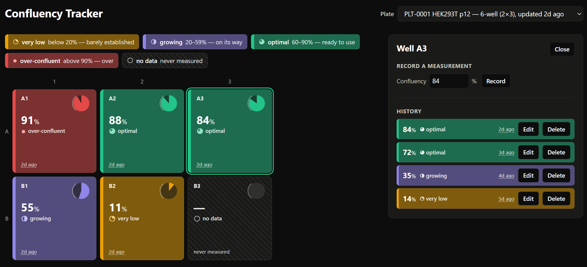

# Cell Culture Confluency Tracker

Track confluency readings for the wells of a cell culture plate. A scientist
picks a plate, reads the whole plate at a glance, and drills into a well to
record, correct or remove a reading.



*A 6-well plate with A3 open. Every well carries its number, its band name and
a distinct glyph, so colour is never the only signal; both themes follow the
OS setting.*

See [CLAUDE.md](CLAUDE.md) for the constraints this was built under and
[HISTORY.md](HISTORY.md) for the running log of decisions.

| Path        | What                                                            |
| ----------- | --------------------------------------------------------------- |
| `backend/`  | Django + Django Ninja API on SQLite, managed with `uv`           |
| `frontend/` | Vite + React + TypeScript, TanStack Query, managed with `pnpm`   |

## Setup

Needs [uv](https://docs.astral.sh/uv/), Node 22+ and [pnpm](https://pnpm.io/).

```bash
cd backend  && uv sync && uv run python manage.py migrate && cd ..
cd frontend && pnpm install && cd ..
```

`migrate` also seeds the demo data — ten 6-well plates and one 96-well plate,
with partial history — because the seed lives in data migrations.

## Running

Two terminals:

```bash
cd backend  && uv run python manage.py runserver   # API on :8000
cd frontend && pnpm dev                            # UI  on :5173
```

Vite proxies `/api` to Django, so the browser only ever talks to one origin
and there is no CORS configuration. API docs at `/api/docs`.

## Tests and checks

```bash
cd backend  && uv run pytest && uv run ruff check . && uv run ruff format --check .
cd frontend && pnpm test && pnpm typecheck && pnpm lint
```

81 backend tests, 210 frontend.

## Data model

```
Plate(name, row_count, col_count, created_at)
Well(plate FK, row_index, col_index)          unique(plate, row_index, col_index)
Measurement(well FK, value, recorded_at, created_at, updated_at, deleted_at)
```

Three decisions carry most of the weight:

**Well labels are derived, never stored.** `A1` is computed from
`row_index`/`col_index` in the frontend, and the grid is sized from
`row_count`/`col_count`. That is what makes a 96-well plate a row in the
database rather than a code change — the 96-well plate is a seed migration and
nothing else.

**Measurements are append-only.** A correction writes a new row carrying the
original's `created_at` forward, so `(well_id, created_at)` identifies one
reading across every version of it. Deletes are soft. Nothing is ever
overwritten, so the history is real history.

Validation lives in two places deliberately: the Ninja schema (`ge=0, le=100`)
produces the 422, and a DB `CheckConstraint` is the backstop.

## API

| Method | Path | Notes |
| --- | --- | --- |
| GET | `/api/plates` | + `well_count`, `last_reading_at`; **1 query** |
| GET | `/api/plates/{id}` | plate and dimensions |
| GET | `/api/plates/{id}/wells` | every well + its latest reading or `null`; **3 queries at any plate size** |
| GET | `/api/plates/{id}/wells/{well}/measurements` | full history, newest first |
| POST | `/api/plates/{id}/wells/{well}/measurements` | `{value, recorded_at?}` → 201 |
| PATCH | `/api/measurements/{id}` | correction; appends a row, retires the old |
| DELETE | `/api/measurements/{id}` | 204, soft delete |

The plate-wells endpoint is the one with a performance requirement: three
queries regardless of well count, never one per well. It costs two stacked
window functions — collapse each reading to its in-force version, *then* rank
by `recorded_at` — and they have to be separate query levels, or Django
computes them side by side and the second ranks rows the first was meant to
drop. `backend/plates/api.py` explains it at the call site; a test asserts the
query count for both 2×3 and 8×12.

## Frontend structure and data flow

```
App                     picks a plate, tracks the selected well
├── PlatePicker         plate list, showing each format
├── BandLegend          the colour/glyph key, always visible
├── PlateGrid           CSS grid sized from the plate; picks its own density
│   └── WellCell        one well — card, or bare dial when compact
│       └── WellDial    SVG pie + optimal-range arc
└── WellPanel           history for the selected well
    └── MeasurementForm record / correct, shared by both
```

TanStack Query owns all server state; React state holds exactly two things,
the picked plate id and the selected well id. Everything else is derived from
the queries, including the selected well itself — it is read back out of the
plate-wells query rather than stored, so after a write the panel shows the
refetched reading instead of a stale snapshot.

The three query keys are declared in one place in `src/api/plates.ts`,
alongside the hooks that read them, because the failure mode for invalidating
a key nothing reads is silent: the request succeeds and the grid does not
update.
Every write invalidates all three — the plate list (its `last_reading_at`
moves), the plate wells (the grid), and that well's history.

Two other things live in one place each. `lib/confluency.ts` owns the band
thresholds, with a test that fails if `60` or `90` appears anywhere else in
the source. `lib/density.ts` decides comfortable vs compact from the plate's
dimensions, so no caller has to guess which rendering to ask for.

## Tooling

| Concern | Backend | Frontend |
| --- | --- | --- |
| Dependencies | `uv`, lockfile committed | `pnpm`, lockfile committed |
| Lint | `ruff` | `oxlint` |
| Types | — | `tsc -b`, strict |
| Tests | `pytest` + `pytest-django` | `vitest` + Testing Library |

Django Ninja over DRF: the schemas are Pydantic, which gives request
validation and the OpenAPI docs for free, and the routers call the ORM
directly with no serializer layer in between. Testing Library over shallow
rendering because the tests should assert what a user can see — most of them
query by accessible name, so they cover the accessibility work at the same
time.

Myyk: I allowed Claude to pick most of it's own tools where not specified in
the prompt. I chose `pnpm` over `npm` just because it seemed faster and more
reliable in past projects and didn't want to spend a ton of time picking these
things for this toy project. These choices are so easily changed in this AI
assisted coding era, it doesn't matter much at this stage.

DB is SQLite, it's easy to use at this stage and doesn't change too much. I
even made the switch to Postgres in the unlanded Dockerized branch. Postgres
is a solid choice for an RDBMS unless you have some good reasons to not use it.
I also chose to use a relational database because the data is naturally relational
and my instinct is to use relational databases until theirs a performance
constraint that disallows it.

I hadn't heard of oxlint before but after looking into it, it seemed like a great
choice so I didn't spend any time trying to steer Claude on this. It did an adequate
amount of linting and static analysis for a small project. I would add more into
the CI pipeline if it were productionized, but this is really good for a 4hr project.

Used Vite because I had some familiarity if things went wrong. Things didn't go wrong.
I never used vitest, but it went fine and it seemed like the right library to use to
keep it as simple as possible.

## What I skipped, and why

- **Auth and users.** Out of scope for the brief; adding them would have cost
  the time that went into the plate view.
- **A service or repository layer, and DRF.** Seven endpoints calling the ORM
  directly is the honest size of this. An abstraction with one implementation
  is a guess about a future that has not arrived.
- **Generated API types.** The seven response shapes are mirrored by hand in
  `src/api/types.ts`, keeping `snake_case` exactly as the wire sends it. A
  codegen pipeline for seven types is more machinery than it saves.
- **Virtualising the 96-well grid.** 96 DOM nodes is nothing.
- **A Python type checker.** `ruff` covers the lint rules that matter here;
  mypy on ~200 lines of view code would have earned less than the same time
  spent on tests.
- **Pagination on well history.** A well accumulates a reading a day, the
  plates are assumed to not be kept for more than a couple weeks.

## Trade-offs and known limitations

- **`Measurement.value` should probably be `confluency`.** If a second kind of
  reading ever gets recorded, `value` is the wrong name and possibly the wrong
  shape. Not renamed now: the migration is easy later, and guessing the shape
  of the second measurement before it exists is how you get the wrong one.
- **Density is verified at 6 and 96 wells, not in between.** The threshold is a
  well count, so intermediate formats resolve to one mode or the other, but
  only the two real formats were looked at on screen.
- **Last write wins.** No optimistic concurrency: two people correcting the
  same reading at once both succeed, and the later one is in force.
- **Not built for touch or small screens.** The grid scrolls sideways rather
  than reflowing, which is the right call for a plate but not for a phone.
- **A containerised setup** (`docker compose up` with Postgres) exists on the
  `containerized-setup` branch. It is not merged, so nothing above depends on
  it.
- **Configuration** I didn't add any configuration file. I think if it were
  productionized I would have the various bands be configurable in app, so
  this seems fine. Claude did some interesting things around testing to make
  sure they were only defined once which although a bit weird is not bad and
  I left it. I left it because I think perhaps it will keep the AI in line
  more and to be honest, it will be the primary coder going forward I would
  imagine.

## Time spent

Roughly six hours of hands-on work, spread over two afternoons — commits span
2h50m on the first day and 2h15m on the second, plus reading and planning
before the first one.

## How I used AI

I changed a string manually once. No other code was needed to be written
by me.

I was shocked by how little time I had to actually spend writing the code
myself. It was my frist time using Claude Code, so I would say there was
time lost by not knowing the tool. If I was trying to go maximal speed, I
would have set it up in a sandbox and let it complete tasks on its own to
completion more rather than watch each step and see what it did. I only
needed to steer it once where it wrote some stupid code. I think I was
effective in my prompting.

There's more notes in [HISTORY.md](HISTORY.md) about the decisions I was
making as I went and how I was prompting it. My focus was on correctness
and stepping back to see if it felt right. Trying to step into the user's
shoes and a beginner's mindset to see if it was easy and pleasing to use.
It was nice to be able to add some nice flares without going over my time
budget. I had a lot more fun with this than I thought I would.